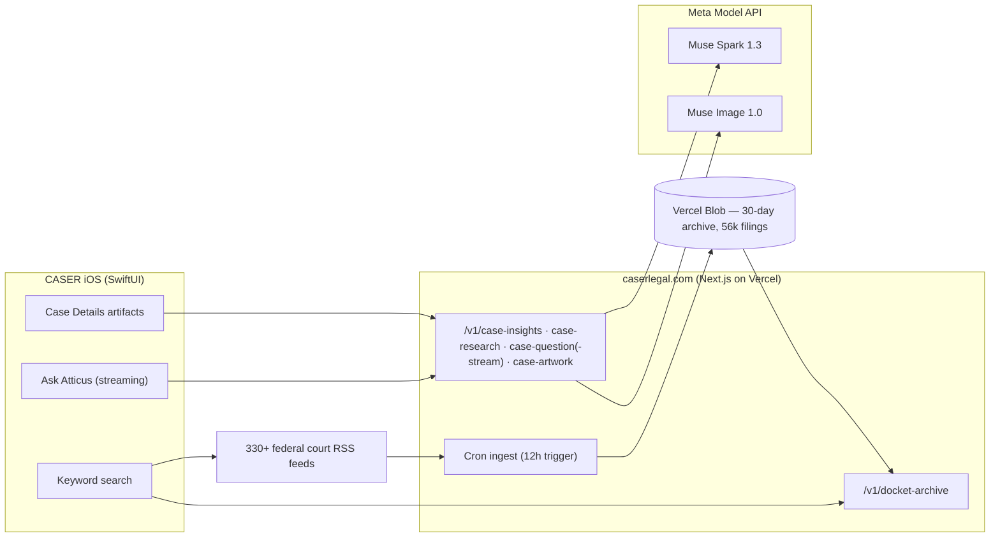

<div align="center">

# CASER

### Federal court filings, explained the moment they land.

**CASER tracks public U.S. federal court filings and turns every docket entry into a plain-English, fully sourced case briefing — powered end to end by Meta Muse.**

[](https://dev.meta.ai/docs)
[](https://dev.meta.ai/docs/image-generation)
[](https://developer.apple.com/xcode/)
[](https://nextjs.org)
[](https://dev.meta.ai/events/global-hackathon)

[Live product](https://www.caserlegal.com) · [Backend repository](https://github.com/caser-legal/www-caserlegal-com) · [Submission notes](#-hackathon-submission)

</div>

---

## Contents

- [The problem](#the-problem)
- [What CASER does](#what-caser-does)
- [See it in a real case](#see-it-in-a-real-case)
- [Built during the hackathon](#-built-during-the-hackathon)
- [How Meta Muse is used](#how-meta-muse-is-used)
- [Architecture](#architecture)
- [The 30-day feed archive](#the-30-day-feed-archive)
- [Run it](#run-it)
- [Testing](#testing)
- [Safety and privacy](#safety-and-privacy)
- [Roadmap](#roadmap)
- [Creator](#creator)

## The problem

Every day, U.S. federal courts publish thousands of docket entries. They are public, free, and almost unreadable: terse clerk shorthand (`[Dismiss] (14)`), unexplained procedure, no story, no context. People learn their own case moved — a dismissal, a deadline, a ruling — from a line of jargon, or they pay per-page fees and still get no explanation. People also ask for refunds when a search only covers today's filings and the filing they *know* exists happened last week.

CASER exists to close that gap: find the filing, explain it in plain English, show the story behind it, cite every source, and keep watching it for you.

## What CASER does

- **Search** every federal district, bankruptcy and appellate court feed by keyword, name, or docket number — across the live feeds *and* a rolling 30-day archive, so past filings are findable, not just today's.
- **Case Details that explain themselves.** Open any filing and Atticus — CASER's case explainer, powered by Meta Muse — fills the page in: *About This Case* first, what the filing means, the terms in the entry, what to watch, who's who, where it stands, a generated timeline, the news, and the sources.
- **Ask Atticus about this case.** Follow-up questions stream in live, token by token, with reasoning, related-docket lookups and cited sources.
- **Alerts and saved cases**, PDF export, and widgets — the working product underneath the AI layer.

## See it in a real case

Open *Cothron v. Casper Police Department et al* (2:26-cv-00180, Wyoming District Court) and the Details page reads like a briefing, not a database row:

1. **About This Case** — "Brenda Cothron is suing over the death of her son, Trae Spurlock…" with optional case artwork generated by Muse Image.
2. **Timeline artifact** — 2024-06-06 the shooting · 2024-06-18 coroner's report · 2026-06-05 case filed · 2026-10-27 docket entry 14, rendered as a visual timeline, not text lines.
3. **Who's Who, Where It Stands, In the News** — each its own titled section, sources collapsed to the first three with a show-all toggle.
4. **Ask Atticus** sits at the top under the case number; answers type out in real time.

> A three-minute demo video accompanies the hackathon submission on the Cerebral Valley platform, walking through exactly this flow on a real device.

## 🏆 Built during the hackathon

**Event:** Meta Global AI Developer Hackathon (Cerebral Valley), Oct 26 – Nov 4, 2026 · **Track:** Indie Developer · **Theme:** Build for Your World · **Solo project.**

CASER is an existing product; per the rules, here is exactly what is **new in this submission** (everything else — court search, alerts, saved cases, the shipping app shell — predates the event and is not claimed as hackathon work):

| New during the hackathon | Where |
|---|---|
| Atticus case intelligence: structured *About This Case* artifact (story, who's who, where it stands, timeline, news) | This repo + backend `case-research` |
| Visual timeline / who's-who / news / source-card artifacts with true section titles on Case Details | `CASER/Features/CaseDetail/` |
| Streaming Ask Atticus (SSE token streaming, reasoning summaries, tool status) | Backend `case-question-stream` + iOS client |
| `search_related_dockets` function tool backed by CASER docket search | Backend `case-intelligence.ts` |
| Muse Image case artwork generation | Backend `case-artwork` + iOS |
| 30-day court-feed archive (12-hour ingest, Blob storage, archive search API + app integration) | Backend `feed-archive.ts` + iOS `FeedArchiveClient` |
| Case Details layout rebuild (About first, Ask at top, actions at bottom, collapsed sources, clean summary) | `CaseDetailView.swift` |

## How Meta Muse is used

Atticus is not a chat box bolted onto an app — every Meta Model API capability that fits a legal briefing does a specific job:

| Capability (Meta Model API) | How CASER uses it |
|---|---|
| **Responses API** (`muse-spark-1.3`) | All case intelligence; reasoning carried across turns |
| **Structured output** (`text.format` JSON schema, strict) | The About artifact is schema-constrained data — story, people, timeline events, news — never free-form text to scrape |
| **Search grounding** (`web_search` tool + citations) | Every factual claim is cited; sources render as source cards with exact passages |
| **Streaming** (`stream: true`) | Answers, reasoning summaries and tool status stream to the phone as they are generated |
| **Reasoning** (`reasoning.effort` + summaries) | A collapsible "Atticus reasoning" artifact shows how an answer was reached |
| **Tool calling** (function tools) | `search_related_dockets` lets Atticus pull related filings from CASER's own court search mid-answer |
| **Muse Image** (`muse-image-1.0`) | Generates editorial case artwork for the About section; its built-in search keeps imagery grounded |
| **Prompt caching** (`prompt_cache_key`) | Repeated case-work prompts stay fast and cheap |

Safety is structural: docket text is treated as untrusted data and can never instruct the model; the model may not invent parties, dates or outcomes; anything unsupported must be reported as not established; every answer is general legal information, never legal advice.

## Architecture



## The 30-day feed archive

Court RSS feeds are a sliding window: miss a week and the filing is gone from the feed, even though the case is real and the user is sure it exists. So the server now keeps the window:

- **Ingest:** every court feed is fetched and parsed every 12 hours (daily Vercel cron plus an authenticated 12-hour trigger), deduplicated by court + entry, stored per-day in private Vercel Blob storage. First production ingest: **56,049 filings from 333 courts**.
- **Hard cap:** shards older than 30 days (or future-dated) are pruned on every run — the archive can never grow past 30 days of filings.
- **Search:** `GET /v1/docket-archive?query=…&days=30` matches names, keywords and normalized docket numbers across the archive; the iOS app merges archive results into every keyword search automatically.

## Run it

**Backend** (in the [companion repository](https://github.com/caser-legal/www-caserlegal-com)):

```bash
npm install
MODEL_API_KEY=… npm run dev   # key: your Meta Model API key
npm test                      # 44 tests, node:test
```

Endpoints: `POST /v1/case-insights`, `POST /v1/case-research`, `POST /v1/case-question`, `POST /v1/case-question-stream` (SSE), `POST /v1/case-artwork`, `GET /v1/docket-archive`, `GET /api/cron/feed-archive` (Bearer `CRON_SECRET`).

**iOS:** open `CASER.xcodeproj`, select the `CASER` scheme, run on an iPhone. The backend URL is the `MUSE_BACKEND_URL` build setting (production: `https://www.caserlegal.com`).

## Testing

- Backend: `npm test` — 44 tests covering prompt-injection defenses on untrusted docket text, structured-output shaping (including fenced, double-encoded and string-encoded model JSON), streaming event forwarding, artwork, and archive ingest dedupe + 30-day pruning.
- TypeScript: `npx tsc --noEmit` clean. iOS: Debug build succeeds (`xcodebuild -scheme CASER`).
- Production verified end to end: live case research, streaming answers with tool calls, generated artwork, and archive search all exercised against www.caserlegal.com.

## Safety and privacy

- Court data is public record; the archive stores only public feed content, capped at 30 days.
- The Meta API key exists only as a server environment variable. No key ships in the app.
- Atticus output is general legal information, not legal advice, and says so in the product.
- Repositories contain no secrets; both are public for judging, per hackathon rules.

## Roadmap

- Push notifications when an archived case moves; per-case docket diffs.
- Muse Voice Transcribe for spoken Ask Atticus questions.
- Party and judge pages assembled from the archive.
- Move the archive to a Pro cron schedule and add vector search over filings.

## Creator

**Adam Doherty** — creator of CASER (Case Alerts & Search of Electronic Records), solo indie developer. CASER is a live product on the App Store; this hackathon entry rebuilds its heart around Meta Muse.

<div align="center">

Built with Meta Muse · Muse Spark 1.3 · Muse Image · Meta Model API

</div>
