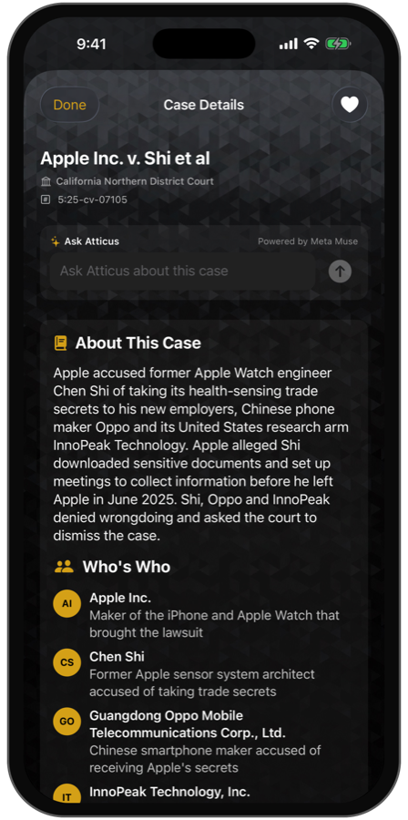
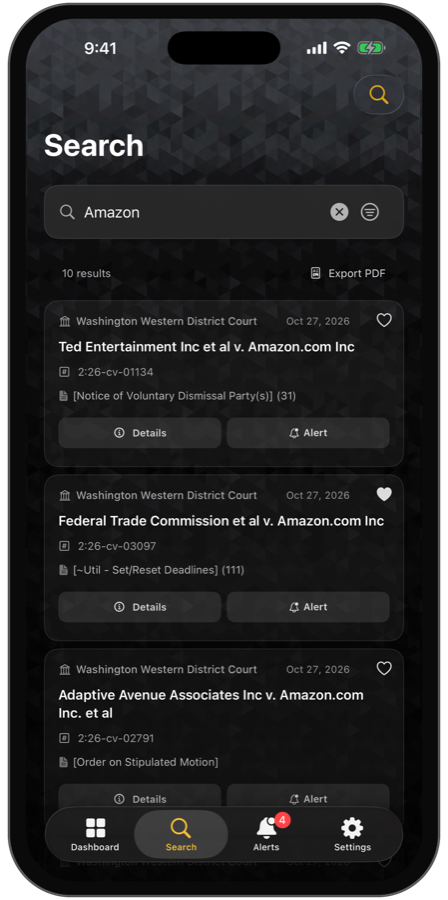
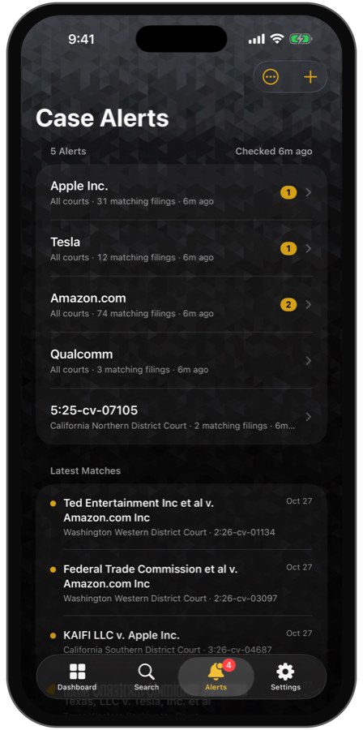
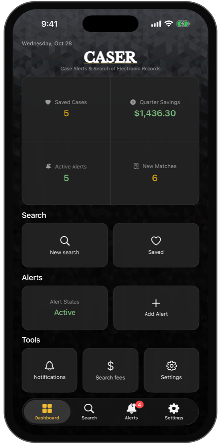
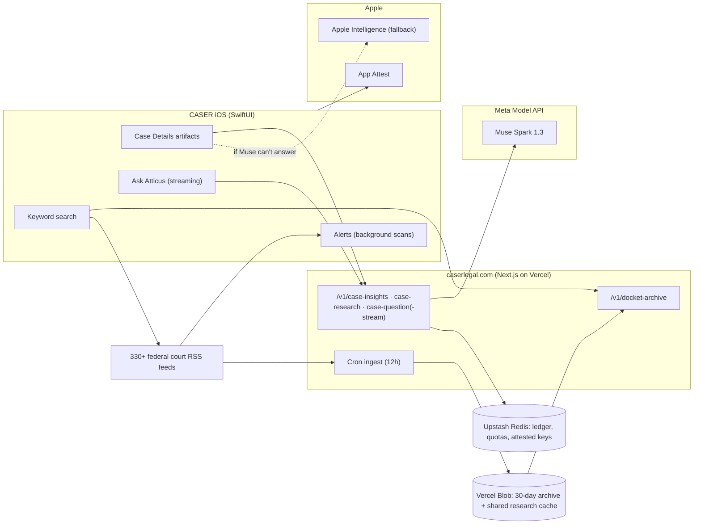

<div align="center">

# CASER

### Federal court filings, explained the moment they land.

**CASER tracks public U.S. federal court filings and turns every docket entry into a plain-English, fully sourced case briefing, powered end to end by Meta Muse.**

[](https://dev.meta.ai/docs)
[](https://developer.apple.com/xcode/)
[](https://nextjs.org)
[](https://dev.meta.ai/events/global-hackathon)

**[Try it on iPhone (TestFlight)](https://testflight.apple.com/join/BhnF2kbQ)** · [Live product](https://www.caserlegal.com) · [Backend repository](https://github.com/caser-legal/www-caserlegal-com) · [Built during the hackathon](#-built-during-the-hackathon)

   

</div>

---

## Contents

- [The problem](#the-problem)
- [Who it's for](#who-its-for)
- [What CASER does](#what-caser-does)
- [See it in a real case](#see-it-in-a-real-case)
- [Built during the hackathon](#-built-during-the-hackathon)
- [How Meta Muse is used](#how-meta-muse-is-used)
- [Engineering](#engineering)
- [Architecture](#architecture)
- [Run it](#run-it)
- [Testing](#testing)
- [Safety and privacy](#safety-and-privacy)
- [Roadmap](#roadmap)
- [Creator](#creator)

## The problem

Every day, U.S. federal courts publish thousands of docket entries. They are public, free, and almost unreadable: terse clerk shorthand (`[Dismiss] (14)`), unexplained procedure, no story, no context. People learn their own case moved (a dismissal, a deadline, a ruling) from a line of jargon, or they pay PACER $0.10 a page and still get no explanation. And because court feeds only show a short window, the filing someone *knows* happened last week has often already scrolled out of reach.

CASER closes that gap: find the filing, explain it in plain English, show the story behind it, cite every source, and keep watching it for you.

## Who it's for

- **People in a case of their own**, often without a lawyer, who need to know what just happened and what comes next.
- **Families, journalists and researchers** following a lawsuit, bankruptcy or prosecution.
- **Small firms and legal professionals** who want alerts on a name, company or case number across every federal court without paying per page.

CASER is a live product on the App Store with paying subscribers. This hackathon entry rebuilds its core around Meta Muse.

## What CASER does

- **Search** every federal district, bankruptcy and appellate court feed by keyword, name or docket number, across the live feeds *and* a rolling 30-day archive, so past filings are findable, not just today's.
- **Case Details that explain themselves.** Open any filing and Atticus, CASER's case explainer powered by Meta Muse, fills the page in: *About This Case*, who's who, where it stands, a timeline, the news, what the filing means, the terms in the entry, what to watch, and the sources behind every claim.
- **Ask Atticus about this case.** Follow-up questions stream in token by token, with reasoning, related-docket lookups and cited sources.
- **Atticus never shows an error.** If Muse can't answer, Atticus falls back to Apple Intelligence on the iPhone, then to a plain-English summary built from the docket itself, and says who wrote it.
- **Alerts and saved cases.** Watch a name, company or case number; CASER checks the feeds in the background and notifies you when a new filing matches. Plus saved cases, PDF export and widgets.

## See it in a real case

Open *Apple Inc. v. Shi et al* (5:25-cv-07105, N.D. Cal.). The feed only says `[Administrative Motion to Consider Whether Another Party's Material Should Be Sealed]`. Atticus turns it into a briefing:

1. **About This Case.** "Apple accused former Apple Watch engineer Chen Shi of taking its health-sensing trade secrets to his new employers, Chinese phone maker Oppo and its United States research arm InnoPeak Technology…", with a tappable source number after each cited claim.
2. **Who's Who.** Apple, Chen Shi, Oppo and InnoPeak, each with their role in the case.
3. **Where It Stands and Timeline.** Complaint filed Aug 21, 2025 → discovery order → sealing order → motions to dismiss denied Sep 30, 2026, rendered as a visual timeline.
4. **In the News.** Bloomberg Law, AppleInsider, MacRumors and HotHardware coverage, summarized, with the 12 sources it used.
5. **What This Filing Is.** The sealing motion explained, its key terms defined, and what to watch for next.

The research for a case is done once and shared: the next person who opens it gets the briefing instantly.

## 🏆 Built during the hackathon

**Event:** Meta Global AI Developer Hackathon (Cerebral Valley), Oct 26 – Nov 4, 2026 · **Track:** Startups (CASER, LLC) · **Theme:** Build for Your World · **Team:** Adam Doherty (solo).

CASER is an existing product, and the rules let startups build on an existing codebase as long as the new work is clearly identified. Here is exactly what is **new in this submission**. Everything else (court search, alerts, saved cases, the shipping app shell) predates the event and is not claimed as hackathon work.

**How to check it in git:**

- **Backend** ([www-caserlegal-com](https://github.com/caser-legal/www-caserlegal-com)): every commit from `c32fa20` (Oct 27, 2026) onward is hackathon work. The commit before it, `e018b59`, is dated Oct 24, before the event started. Run `git log c32fa20~1..main`.
- **iOS** (this repository): created during the event. Its first commit, `78e7f9d`, imports the existing CASER app together with the first hackathon changes. Use the table below to separate the two.

| New during the hackathon | Where |
|---|---|
| Atticus case intelligence: structured *About This Case* artifact (story, who's who, where it stands, timeline, news) | This repo + backend `case-research` |
| Visual timeline / who's-who / news / source-card artifacts with section titles on Case Details | `CASER/Features/CaseDetail/` |
| Streaming Ask Atticus (SSE token streaming, reasoning summaries, tool status) | Backend `case-question-stream` + iOS client |
| `search_related_dockets` function tool backed by CASER docket search | Backend `case-intelligence.ts` |
| Inline citations from Meta's `url_citation` annotations: offsets in the raw JSON are mapped onto the story, so each claim gets a tappable source number that matches a numbered source card | Backend `citeFields` + iOS `CitedProse` |
| Shared research cache: a case is researched once and served to everyone after | Backend `case-intelligence.ts` |
| Fallback chain so Atticus always answers: Muse → Apple Intelligence → docket summary | `CASER/Services/Muse/AtticusFallback.swift` |
| Apple App Attest with a signed assertion on every Atticus request, so a copied token can't be replayed | iOS `DeviceAttestor` + backend `device-attest.ts` |
| Measured cost: every Muse call's real cost recorded in a ledger, a monthly budget cap, per-device abuse limits | Backend `metering.ts`, `meter-store.ts` |
| Reliability: research answers that Muse cut off (`status: incomplete`) or that are not valid JSON are rejected, never shown as raw JSON | Backend `caseResearch` + iOS `CaseInsightsModel` |
| 30-day court-feed archive (12-hour ingest, Blob storage, archive search API + app integration) | Backend `feed-archive.ts` + iOS `FeedArchiveClient` |
| PDF export redesign: CASER logo, black and gold palette, one-line result rows with readable court abbreviations | `CASER/Services/PDF/` |
| Case Details layout rebuild (About first, Ask at top, actions at bottom, collapsed sources) | `CaseDetailView.swift` |

## How Meta Muse is used

Atticus is not a chat box bolted onto an app. Every Meta Model API capability that fits a legal briefing does a specific job:

| Capability (Meta Model API) | How CASER uses it |
|---|---|
| **Responses API** (`muse-spark-1.3`) | All case intelligence; reasoning carried across turns |
| **Structured output** (`text.format` JSON schema, strict) | The About artifact is schema-constrained data (story, people, timeline events, news), never free-form text to scrape. Answers that are incomplete or don't parse are rejected |
| **Search grounding** (`web_search` + `url_citation` annotations) | Annotation offsets are mapped from the raw JSON onto the story, so each cited claim carries a tappable source number that matches a numbered source card |
| **Streaming** (`stream: true`) | Answers, reasoning summaries and tool status stream to the phone as they are generated |
| **Reasoning** (`reasoning.effort` + summaries) | A collapsible "Atticus reasoning" artifact shows how an answer was reached |
| **Tool calling** (function tools) | `search_related_dockets` lets Atticus pull related filings from CASER's own court search mid-answer |
| **Contributor mode** (`muse-spark-1.3-contributor`) | Research on public court records runs in Contributor mode at a fraction of the cost; the questions people type stay in Standard mode and are never used for training |
| **Built-in tool limits** (`max_tool_calls`) | Research is capped at 4 web searches, keeping a briefing fast and predictable |
| **Prompt caching** (`prompt_cache_key`) | Repeated case-work prompts stay fast and cheap |

Measured in production: about **$0.015 per new case briefing** and **$0.009 per question**, and **$0** for any case someone has already opened. That is what lets a $14.99/year plan include 100 briefings and 100 questions a month.

Safety is structural: docket text is treated as untrusted data and can never instruct the model; the model may not invent parties, dates or outcomes; anything unsupported is reported as not established; every answer is general legal information, never legal advice.

## Engineering

- **Always an answer.** Muse → Apple Intelligence on device → a deterministic docket summary that parses chapter, trustee and case type. Fallback answers are labeled and never cached as if they were Muse's, so the next open tries Muse again.
- **Only the real app can call Atticus.** Apple App Attest verifies the install once; after that, every request carries a signed assertion over method, path, body hash and time, checked against a stored public key and an always-increasing counter. Parallel requests that arrive out of order are accepted once and never again.
- **Cost is measured, not estimated.** Each Muse call's token and search usage is priced and written to a Redis ledger; `npm run cost-report` prints cost per briefing, per question and the cache-hit rate. A monthly budget for free usage can never pause paying users, and a hard cap protects the whole account.
- **Subscriptions stay honest.** StoreKit 2 transactions are verified on the server against Apple's root certificates, and App Store Server Notifications revoke refunded subscriptions and purchases.

## Architecture



**The 30-day archive.** Court RSS feeds are a sliding window: miss a week and the filing is gone from the feed. The server keeps the window instead. Every court feed is fetched every 12 hours, deduplicated by court and entry, and stored per day; the first production ingest held **56,049 filings from 333 courts**. Anything older than 30 days is pruned on every run, and the app merges archive results into every search.

## Run it

**On iPhone:** install the [TestFlight build](https://testflight.apple.com/join/BhnF2kbQ). Everything is unlocked. Search for a company (try "Apple"), tap **Details**, turn on Atticus, and watch the briefing fill in; then ask a question at the top.

**Backend** (in the [companion repository](https://github.com/caser-legal/www-caserlegal-com)):

```bash
npm install
MODEL_API_KEY=… npm run dev   # your Meta Model API key
npm test                      # 129 tests, node:test
```

**iOS:** open `CASER.xcodeproj`, select the `CASER` scheme and run on an iPhone (App Attest needs a real device). The backend URL is the `MUSE_BACKEND_URL` build setting; production is `https://www.caserlegal.com`.

## Testing

- **Backend:** 129 tests covering prompt-injection defenses on untrusted docket text, structured-output shaping, rejection of incomplete or malformed Muse answers, citation offset mapping, streaming, archive dedupe and pruning, App Attest attestation and assertions (replay, out-of-order counters, tampered bodies), metering and budget caps, StoreKit verification and App Store notifications. TypeScript is clean under `tsc --noEmit`.
- **Production, end to end:** live case research, streaming answers with tool calls, archive search and signed requests from a real iPhone against www.caserlegal.com.
- **Alerts:** verified against the live court feeds: case-sensitive and state-filtered matching, nothing from before an alert started, no duplicates, no repeat notifications on rescan, and a notification tap opens the match.

## Safety and privacy

- Court data is public record; the archive stores only public feed content, capped at 30 days.
- The Meta API key lives only in the server environment. No key ships in the app.
- Saved cases, alerts, and your Atticus questions and answers stay on your iPhone.
- Atticus output is general legal information, not legal advice, and says so in the product.
- The [privacy policy](https://www.caserlegal.com/privacy) describes exactly what the server keeps and why.

## Roadmap

- Apple Private Cloud Compute as the first fallback (the code and entitlement are in place; it ships with the Xcode 27 build).
- Push notifications when an archived case moves; per-case docket diffs.
- Muse Voice Transcribe for spoken Ask Atticus questions.
- Party and judge pages assembled from the archive.

## Creator

**Adam Doherty**: founder of CASER, LLC and creator of CASER (Case Alerts & Search of Electronic Records). CASER is a live product on the App Store; this hackathon entry rebuilds its heart around Meta Muse.

<div align="center">

Built with Meta Muse · Muse Spark 1.3 · Meta Model API

</div>
