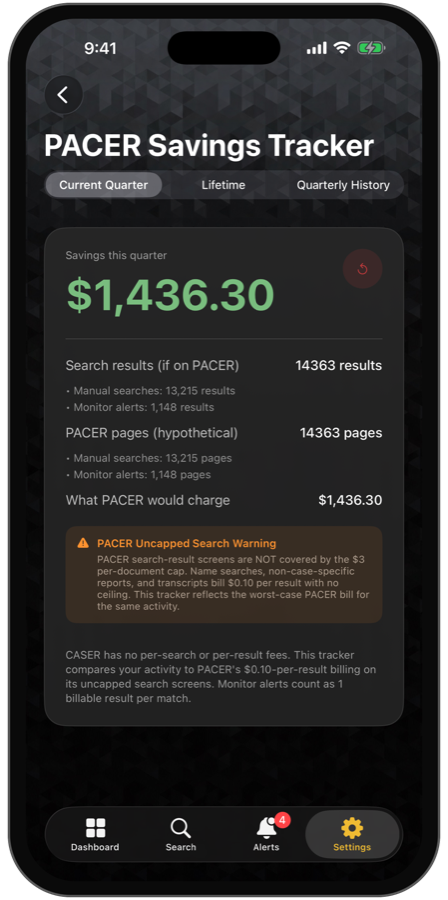
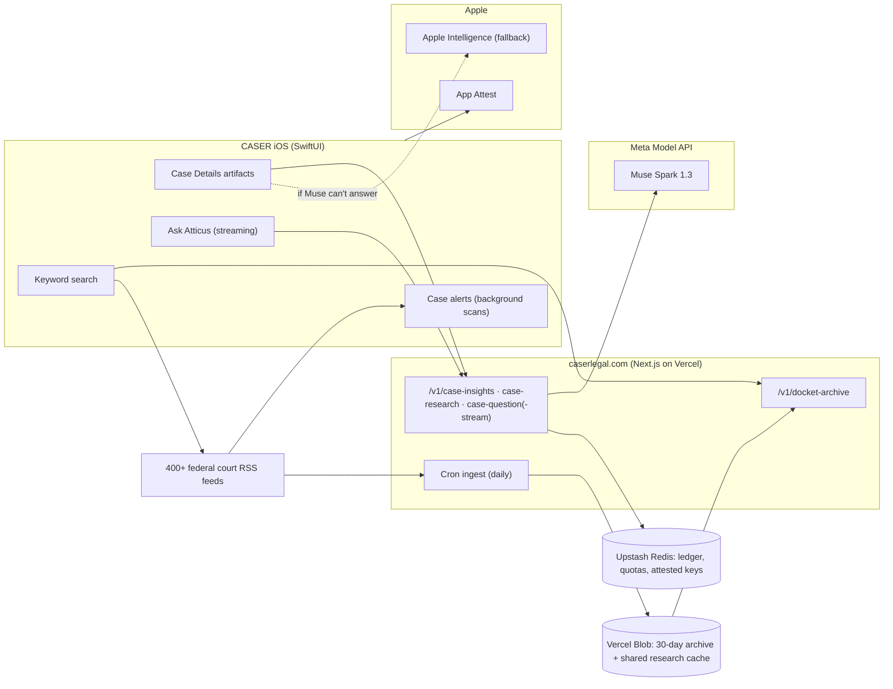

<div align="center">

# Case Alerts & Search by CASER

### Federal court filings, explained the moment they land.

**CASER tracks public U.S. federal court filings and turns every docket entry into a plain-English, fully sourced case briefing, powered end to end by Meta Muse.**

[](https://dev.meta.ai/docs)
[](https://developer.apple.com/xcode/)
[](https://nextjs.org)
[](https://dev.meta.ai/events/global-hackathon)

[](https://youtu.be/dX9PhslaSR0)
[](https://testflight.apple.com/join/BhnF2kbQ)
[](https://www.caserlegal.com/muse)
[](https://apple.caserlegal.com)
[](https://github.com/caser-legal/www-caserlegal-com)

<a href="https://youtu.be/dX9PhslaSR0"></a>

<sub><b>▶ <a href="https://youtu.be/dX9PhslaSR0">Watch the demo on YouTube</a></b></sub>

<table>
  <tr>
    <td align="center"><br><sub><b>Case tracker</b></sub></td>
    <td align="center"><br><sub><b>Atticus case briefing</b></sub></td>
    <td align="center"><br><sub><b>Case alerts</b></sub></td>
    <td align="center"><br><sub><b>Federal search</b></sub></td>
    <td align="center"><br><sub><b>PACER savings</b></sub></td>
  </tr>
</table>

</div>

> [!TIP]
> **Judges:** install the [TestFlight build](https://testflight.apple.com/join/BhnF2kbQ) (everything is unlocked), search for **Apple**, tap **Details** on any case and turn on Atticus. A new case takes up to a minute while Atticus researches it; any case someone has already opened appears instantly.

---

## Contents

| | | |
|---|---|---|
| [The problem](#the-problem) | [Who it's for](#who-its-for) | [What CASER does](#what-caser-does) |
| [See it in a real case](#see-it-in-a-real-case) | [Built during the hackathon](#-built-during-the-hackathon) | [How Meta Muse is used](#how-meta-muse-is-used) |
| [Engineering](#engineering) | [Architecture](#architecture) | [Run it](#run-it) |
| [Testing](#testing) | [Safety and privacy](#safety-and-privacy) | [Roadmap](#roadmap) |

## The problem

Every day, U.S. federal courts publish thousands of docket entries. They are public, free and almost unreadable: terse clerk shorthand (`[Dismiss] (14)`), unexplained procedure, no story and no context. People learn that their own case moved (a dismissal, a deadline, a ruling) from a single line of jargon, or they pay PACER $0.10 a page and still get no explanation. And because a court's RSS feed shows only about the last 24 hours, a filing someone *knows* happened last week has already scrolled out of reach. Unless you refresh every court's feed every day, sometimes for months between filings, you miss what just happened.

> [!IMPORTANT]
> CASER closes that gap: it finds the filing, explains it in plain English, shows the story behind it, cites every source and keeps watching the case for you.

## Who it's for

| Who | What they get |
|---|---|
| ⚖️ **People in a case of their own**, often without a lawyer | What just happened, what it means and what to watch next |
| 📰 **Families, journalists and researchers** | The story of a lawsuit, bankruptcy or prosecution, with sources |
| 🏢 **Small firms and legal professionals** | Alerts on a name, company or case number across every federal court, with no per-page fees |

CASER is already live on the App Store with paying subscribers. This hackathon entry rebuilds its core around Meta Muse.

## What CASER does

- 🔎 **Search** every federal district, bankruptcy and appellate court feed by keyword, name or docket number, across the live feeds *and* a rolling 30-day archive, so past filings are findable, not just today's.
- 📄 **Case Details that explain themselves.** Open any filing and Atticus, CASER's case explainer powered by Meta Muse, fills in the page: *About This Case*, who's who, where it stands, a timeline, the news, what the filing means, the terms in the entry, what to watch and the sources behind every claim.
- 💬 **Ask Atticus about this case.** Follow-up answers stream in token by token, with reasoning, related-docket lookups and cited sources.
- 🛟 **Atticus never shows an error.** If Muse can't answer, Atticus falls back to Apple Intelligence on the iPhone, then to a plain-English summary built from the docket itself, and it says who wrote the answer.
- 🔔 **Case alerts and saved cases.** Watch a name, company or case number; CASER checks the feeds in the background and notifies you when a new filing matches. Saved cases, PDF export and widgets round it out.

## See it in a real case

Open *Apple Inc. v. Shi et al* (5:25-cv-07105, N.D. Cal.). The court feed says only `[Administrative Motion to Consider Whether Another Party's Material Should Be Sealed]`. Atticus turns that into a briefing:

| Section | What Atticus shows |
|---|---|
| **About This Case** | "Apple accused former Apple Watch engineer Chen Shi of taking its health-sensing trade secrets to his new employers, Chinese phone maker Oppo and its United States research arm InnoPeak Technology…", with a tappable source number after each cited claim |
| **Who's Who** | Apple, Chen Shi, Oppo and InnoPeak, each with its role in the case |
| **Where It Stands** and **Timeline** | Complaint filed Aug 21, 2025 → discovery order → sealing order → motions to dismiss denied Sep 30, 2026, drawn as a visual timeline |
| **In the News** | Coverage from Bloomberg Law, AppleInsider, MacRumors and HotHardware, summarized, with the 12 sources it used |
| **What This Filing Is** | The sealing motion explained, its key terms defined and what to watch for next |

## 🏆 Built during the hackathon

| | |
|---|---|
| **Event** | Meta Global AI Developer Hackathon (Cerebral Valley), Oct 26 – Nov 4, 2026 |
| **Track** | Startups (CASER) |
| **Theme** | Build for Your World |
| **Team** | Adam Doherty (solo) |

CASER is an existing product, and the rules let startups build on an existing codebase as long as the new work is clearly identified. The table below lists exactly what is **new in this submission**. Everything else (court search, alerts, saved cases and the shipping app shell) predates the event and is not claimed as hackathon work.

<details>
<summary><b>How to check it in git</b></summary>

- **Backend** ([www-caserlegal-com](https://github.com/caser-legal/www-caserlegal-com)): hackathon work starts at `c32fa20` (Oct 27, 2026). The commit before it, `e018b59`, is dated Oct 24, before the event started. A few later commits are routine site updates (footer, styling, pricing copy). Run `git log c32fa20~1..main`.
- **iOS** (this repository): created during the event. Its first commit, `78e7f9d`, imports the existing CASER app together with the first hackathon changes; use the table below to tell the two apart.

</details>

| New during the hackathon | Where |
|---|---|
| Atticus case intelligence: the structured *About This Case* artifact (story, who's who, where it stands, timeline, news) | This repo + backend `case-research` |
| Visual timeline, who's who, news and source-card artifacts with section titles on Case Details | `CASER/Features/CaseDetail/` |
| Streaming Ask Atticus (SSE token streaming, reasoning summaries, tool status) | Backend `case-question-stream` + iOS client |
| The `search_related_dockets` function tool, backed by CASER's docket search | Backend `case-intelligence.ts` |
| Inline citations from Meta's `url_citation` annotations: offsets in the raw JSON are mapped onto the story, so each claim gets a tappable source number that matches a numbered source card | Backend `citeFields` + iOS `CitedProse` |
| A shared research cache: each case is researched once and served to everyone after | Backend `case-intelligence.ts` |
| A fallback chain so Atticus always answers: Muse → Apple Intelligence → docket summary | `CASER/Services/Muse/AtticusFallback.swift` |
| Apple App Attest with a signed assertion on every Atticus request, so a copied token can't be replayed | iOS `DeviceAttestor` + backend `device-attest.ts` |
| Measured cost: every Muse call's real cost recorded in a ledger, plus a monthly budget cap and per-device abuse limits | Backend `metering.ts`, `meter-store.ts` |
| Reliability: research answers that Muse cut off (`status: incomplete`) or that aren't valid JSON are rejected, never shown as raw JSON | Backend `caseResearch` + iOS `CaseInsightsModel` |
| A 30-day court-feed archive (daily ingest, Blob storage, archive search API and app integration) | Backend `feed-archive.ts` + iOS `FeedArchiveClient` |
| A PDF export redesign: CASER logo, black and gold palette, one-line result rows with readable court abbreviations | `CASER/Services/PDF/` |
| A Case Details layout rebuild (About first, Ask at the top, actions at the bottom, collapsed sources) | `CaseDetailView.swift` |

## How Meta Muse is used

Atticus is not a chat box bolted onto an app. Every Meta Model API capability that fits a legal briefing does a specific job:

| Capability (Meta Model API) | How CASER uses it |
|---|---|
| **Responses API** (`muse-spark-1.3`) | All case intelligence, with reasoning carried across turns |
| **Structured output** (`text.format` JSON schema, strict) | The About artifact is schema-constrained data (story, people, timeline events, news), never free-form text to scrape. Answers that are incomplete or don't parse are rejected |
| **Search grounding** (`web_search` + `url_citation` annotations) | Annotation offsets are mapped from the raw JSON onto the story, so each cited claim carries a tappable source number that matches a numbered source card |
| **Streaming** (`stream: true`) | Answers, reasoning summaries and tool status stream to the phone as they are generated |
| **Reasoning** (`reasoning.effort` + summaries) | A collapsible "Atticus reasoning" artifact shows how an answer was reached |
| **Tool calling** (function tools) | `search_related_dockets` lets Atticus pull related filings from CASER's own court search mid-answer |
| **Contributor mode** (`muse-spark-1.3-contributor`) | Research on public court records runs in Contributor mode at a fraction of the cost; the questions people type stay in Standard mode and are never used for training |
| **Built-in tool limits** (`max_tool_calls`) | Research is capped at four web searches, which keeps each briefing fast and predictable |
| **Prompt caching** (`prompt_cache_key`) | Repeated case-work prompts stay fast and cheap |

> [!NOTE]
> **Measured in production:** about **$0.015** per new case briefing, **$0.009** per question and **$0** for any case someone has already opened. That is what lets a $14.99-a-year plan include 100 briefings and 100 questions every month.

Safety is structural. Docket text is treated as untrusted data and can never instruct the model; the model may not invent parties, dates or outcomes; anything unsupported is reported as not established; and every answer is general legal information, never legal advice.

## Engineering

| | |
|---|---|
| 🛟 **Always an answer** | Muse → Apple Intelligence on the device → a deterministic docket summary that parses the chapter, trustee and case type. Fallback answers are labeled and never cached as if they came from Muse, so the next open tries Muse again |
| 🔐 **Only the real app can call Atticus** | Apple App Attest verifies the install once. After that, every request carries a signed assertion over the method, path, body hash and time, checked against a stored public key and an always-increasing counter. Parallel requests that arrive out of order are accepted once and never again |
| 📊 **Cost is measured, not estimated** | Each Muse call's token and search usage is priced and written to a Redis ledger, and `npm run cost-report` prints the cost per briefing, per question and the cache-hit rate. A monthly budget for free usage can never pause paying users, and a hard cap protects the whole account |
| 🧾 **Subscriptions stay honest** | StoreKit 2 transactions are verified on the server against Apple's root certificates, and App Store Server Notifications revoke refunded subscriptions and purchases |

## Architecture



<details>
<summary><b>The 30-day feed archive</b></summary>

Court RSS feeds are a sliding window: miss a week and the filing is gone from the feed. The server keeps the window instead. Every court feed is fetched daily, deduplicated by court and entry, and stored by day; the first production ingest held **56,049 filings from 333 court feeds**. Anything older than 30 days is pruned on every run, and the app merges archive results into every search.

</details>

## Run it

**On iPhone:** install the [TestFlight build](https://testflight.apple.com/join/BhnF2kbQ); everything is unlocked. Search for a company (try **Apple**), tap **Details**, turn on Atticus and watch the briefing fill in, then ask a question in the box at the top.

**Backend** (in the [companion repository](https://github.com/caser-legal/www-caserlegal-com)):

```bash
npm install
MODEL_API_KEY=… npm run dev   # your Meta Model API key
npm test                      # 129 tests, node:test
```

**iOS:** open `CASER.xcodeproj`, select the `CASER` scheme and run it on an iPhone (App Attest needs a real device). The backend URL is the `MUSE_BACKEND_URL` build setting; in production it is `https://www.caserlegal.com`.

## Testing

| Area | What is covered |
|---|---|
| **Backend (129 tests)** | Prompt-injection defenses on untrusted docket text, structured-output shaping, rejection of incomplete or malformed Muse answers, citation offset mapping, streaming, archive dedupe and pruning, App Attest attestation and assertions (replays, out-of-order counters, tampered bodies), metering and budget caps, StoreKit verification and App Store notifications. TypeScript is clean under `tsc --noEmit` |
| **Production, end to end** | Live case research, streaming answers with tool calls, archive search and signed requests from a real iPhone against www.caserlegal.com |
| **Case alerts** | Checked against the live court feeds: case-sensitive and state-filtered matching, nothing from before an alert started, no duplicates, no repeat notifications on a rescan, and a notification tap opens the match |

## Safety and privacy

- 🏛️ Court data is public record; the archive stores only public feed content and never keeps more than 30 days.
- 🔑 The Meta API key lives only in the server environment. No key ships in the app.
- 📱 Saved cases, alerts, and your Atticus questions and answers stay on your iPhone.
- ⚖️ Atticus output is general legal information, not legal advice, and the app says so.
- 📜 The [privacy policy](https://www.caserlegal.com/privacy) describes exactly what the server keeps and why.

## Roadmap

- [ ] Apple Private Cloud Compute as the first fallback (the code and entitlement are in place; it ships with the Xcode 27 build)
- [ ] Push notifications when an archived case moves, with per-case docket diffs
- [ ] Muse Voice Transcribe for spoken Ask Atticus questions
- [ ] Party and judge pages assembled from the archive

## Creator

**[Adam Doherty](https://apple.caserlegal.com)** is the founder and creator of CASER (Case Alerts & Search of Electronic Records). CASER wasn't built to be a business. It started last year as an Automator workflow Adam made to follow his own federal case, grew into a live App Store product, and this hackathon entry, his first, rebuilds its heart around Meta Muse.

Thank you to Meta, Muse (the one with fur, and the model) and Cerebral Valley. Court records have always been public. Let's keep it that way.

<div align="center">

<sub>Built with Meta Muse · Muse Spark 1.3 · Meta Model API</sub>

</div>
